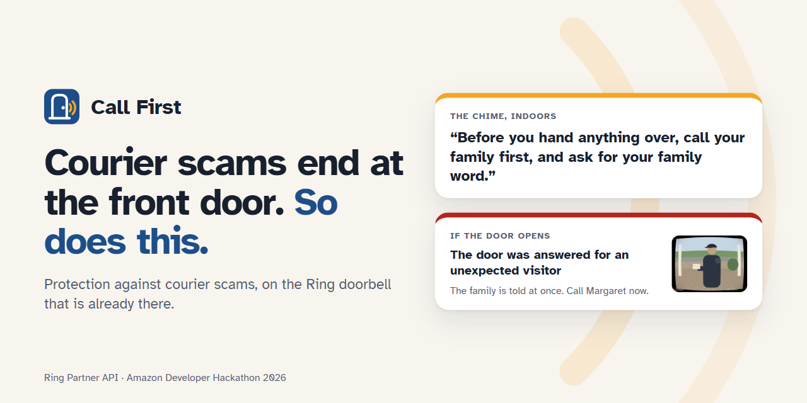

<p align="center"></p>

# Call First

**Courier scams end at the front door. So does this.**

**Live demo: [callfirst-bgtj.onrender.com/try](https://callfirst-bgtj.onrender.com/try)**
(a free instance: the first load after a quiet spell takes about a minute)

A courier scam starts on the phone — a fake grandchild, a fake federal agent —
and ends when a courier comes to an older person's home to collect cash or
gold. The FBI counted at least 1,737 of these pickups, about $186 million, from
2023 to May 2025. The victim is *expecting* the courier, so "alert on
strangers" does not help.

Call First works on the Ring doorbell that is already there:

1. **An unexpected visitor rings** — not a declared visit, not a declared
   delivery — and the chime plays: *"Before you hand anything over, call your
   family first, and ask for your family word."*
2. **The door is opened for them** — and the family is told now, with the
   doorbell's still image and how sure the system is.
3. **The courier comes back** — couriers often do — and during the following
   week the family is told as soon as an unexpected visitor appears.
4. **The resident is talked into switching it off** — and the family is told
   that too. Scammers demand secrecy; this breaks it.

The resident switches it on and chooses who is told. No faces are recognised,
no police are called, and a language model decides nothing. The full reasoning
is in [DESIGN.md](DESIGN.md).

## Readable, measured

The typeface is Atkinson Hyperlegible, drawn by the Braille Institute for readers
with low vision — the people this protects. That is a choice; `python scripts/a11y.py`
is the check that the choice survives contact with the stylesheet:

```
30 colour pairs checked in two themes: all above the WCAG minimum.
```

Every pair the stylesheet actually puts on screen, in light and dark, against WCAG 2.1
— 4.5:1 for text, 3:1 for the focus ring. It found a real defect: the focus ring measured
**1.88:1** against the page, where a keyboard user with low vision needs 3:1 to find it at
all. The accent is now `#c2620b` and measures 9.73:1.

Card borders are reported and not enforced, on purpose: a card is already told apart by its
surface colour, its shadow and its padding, so its border is decoration rather than
information. Darkening eleven borders to satisfy a rule that does not bind would help nobody.

## Measured, not demonstrated

`python scripts/scenarios.py`:

| Scenario | Sensor: reminder / told | Doorbell only: reminder / told |
|---|---|---|
| Courier pickup: rings, door opens, stays 95 s | yes / answered | yes / answered |
| Quick handover: door opens, gone in 25 s | yes / answered | yes / - |
| Carer inside their declared window | no / - | no / - |
| Signature delivery inside its declared window | no / - | no / - |
| Unannounced parcel drop, door never opened | yes / - | yes / - |
| Neighbour drops by, door opens (false alert) | yes / answered | yes / answered |
| Courier returns two days after an alert | yes / heightened | yes / heightened |
| Protection paused during the day | no / change | no / change |
| Pasted 'delivery' that is really a collection | yes / answered | yes / answered |
| Forged webhook without a valid signature | no / rejected | no / rejected |
| Doorbell offline during a visit | yes / blind | yes / blind |

Two rows are failures, reported as such: the neighbour is a false alert, and
without a door sensor a handover under a minute is missed.

### Through an unreliable pipe

Webhooks get lost, duplicated and delayed. `python scripts/chaos.py 20 <seed>`
runs the emulator in its `delivery` chaos mode and plays a courier visit at 20
doors at once. Three seeds (7, 11, 23), 60 visits:

| | |
|---|---|
| Webhooks dropped / duplicated / delayed | 21 / 76 / 159 |
| Families told | **60 / 60** |
| Reminder played twice | **0** |
| Reminders played | 53 / 60 |

A lost "door opened" webhook is caught by asking the sensor while an unexpected
visitor is at the door, which is why every family was told. A lost doorbell
press cannot be recovered: nothing else says someone rang, so 7 reminders did
not play. This run also found a real bug: one SQLite connection shared by
threads returned errors under load; every statement is now serialised.

## Security

The system knows when an older person is alone and it faces people who are
already manipulating them. Four threats, each with tests:

| Threat | Defence | Tests |
|---|---|---|
| The victim is coached to switch it off | every change that weakens protection today alerts the family; a pause ends by itself after 24 h | `test_rules.py` |
| A fake "delivery" notice makes the courier look expected (prompt injection) | readers only propose; code refuses collections by the text itself and requires the tracking number to appear in it | `test_deliveries.py` |
| Forged or replayed webhooks | HMAC over the raw body before parsing, freshness from the signed body, one action per `request_id` | `test_webhooks.py`, `test_app.py` |
| The schedule leaks | households, alerts and the journal encrypted at rest; one call deletes everything | `test_app.py` |

`python scripts/mutate.py` breaks 32 of these rules one at a time; the suite
catches all 32. Reading pasted messages with a model is limited to 20 per
household per hour (OWASP LLM10).

## Who sees what

- **The resident** opens their own link and controls everything: switch on and
  off, pause, expected visits and deliveries, who is told, delete it all.
- **A trusted person** opens theirs and sees whether the protection is on, the
  alerts with their images, and a report sheet for each incident, ready for
  [IC3](https://www.ic3.gov) and the [FTC](https://reportfraud.ftc.gov). Never
  the schedule. They can stop receiving alerts; the others are told.
- Links are exchanged once for an HttpOnly, SameSite=Strict cookie and stored
  only as hashes. Pages load nothing from other origins (strict CSP).

## Try it online

The hosted demo gives every visitor their own household and a front door to
play from the browser: *someone rings*, *open the door*... Each button goes to
the Ring emulator running beside the service (bound to localhost, never
exposed), which sends a signed webhook back, exactly as Ring would. The chime's
reminder is spoken by the browser. Demo households are deleted after two hours.

Deploying it is one Render Blueprint (`render.yaml`): Render generates every
secret; `OPENAI_API_KEY` is optional. `scripts/hosted.py` is the start
command.

## Run it

```bash
python -m venv .venv && .venv/Scripts/pip install -r requirements.txt
.venv/Scripts/python -m pytest              # 146 tests
python scripts/setup_sandbox.py             # the Ring emulator, pinned by hash, own venv
.venv/Scripts/python scripts/live.py        # both servers, real signed webhooks
```

`scripts/live.py` starts the emulator and the service, registers a webhook,
plays a courier visit and checks that the chime played inside the emulator and
the family was emailed, with the image.

`scripts/demo.py` does the same setup, prints Margaret's and Sarah's links, and
lets you play the front door from the keyboard (`r` ring, `o` door opens...).
Alert emails land in `data/demo/mail/`. With `OPENAI_API_KEY` set (or
`ANTHROPIC_API_KEY`), pasted delivery messages are read by a model (it
proposes; code decides); without one, by rules.

## Built on

- The [Ring Partner API](https://developer.amazon.com/docs/ring/api-documentation.html):
  `button_press`, `motion_detected` (human), `contact_sensor_faulted`,
  `device_online/offline` webhooks; image snapshots; chime playback.
- [ring-sandbox](https://github.com/josepha-mayo/ring-sandbox) (MIT) as the
  emulator, read in full before use. Ring publishes no simulator; see
  [FRICTION.md](FRICTION.md).

MIT licensed.
